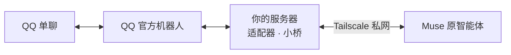

<div align="center">

<h1>Muse QQ Bridge</h1>

<p>在 QQ 单聊中，与 Muse 里的原智能体对话。</p>

<p>
  <a href="https://github.com/anan-21/muse-qq-bridge/actions/workflows/tests.yml"></a>
  <a href="docs/quickstart.md"></a>
  <a href="LICENSE"></a>
</p>

<p>
  <a href="docs/quickstart.md">快速开始</a> ·
  <a href="docs/muse-integration.md">接入 Muse</a> ·
  <a href="docs/latency.md">延迟实测</a> ·
  <a href="SECURITY.md">安全说明</a>
</p>

</div>

## 能做什么

把 QQ 官方机器人单聊接入你已有的 Muse 会话。智能体结合自己的记忆和工具生成回复，服务器负责传递消息、保存待办和确认发送。

| 能力 | 使用方式 |
| --- | --- |
| 沿用原智能体 | 由 Muse 自行判断是否搜索、查记忆或调用工具 |
| 正文随唤醒带入 | 钩子先取消息正文，智能体直接使用；取件失败时按原流程补取 |
| 单次发送与确认 | 回复 helper 取得有效消息回执后，再确认本批消息 |
| 按阶段定位延迟 | 私有日志记录脚本启动、发送返回和确认返回的时间 |

## 接入流程



桥服务保留未确认消息，直到回复成功并完成确认。发送结果未知时，需要先核查结果，避免自动重发。

## 快速开始

开始前准备以下环境。

- **QQ 官方机器人**，已具备开发者资格和沙箱单聊能力。
- **Linux 服务器**，Python 3.12+，可通过 Tailscale 私网提供桥服务。
- **Muse 工具环境**，具备后台钩子与 shell 执行能力，并能实际访问桥的私网地址。

当前覆盖单一主人、纯文本、被动回复。完整安装按 [五步接入指南](docs/quickstart.md) 进行，服务器初始化命令如下。

```bash
git clone https://github.com/anan-21/muse-qq-bridge.git
cd muse-qq-bridge
python3 -m venv .venv
.venv/bin/python -m pip install -r requirements.txt
.venv/bin/python configure.py --appid YOUR_APP_ID
```

将 `YOUR_APP_ID` 替换为自己的 AppID，按提示在服务器终端隐藏输入 AppSecret。接着完成 [启动与绑定](docs/quickstart.md#3-启动并绑定)、[私网连接](docs/quickstart.md#4-通过私网连接-muse) 和 [Muse 接入](docs/quickstart.md#5-让-muse-中的原智能体接管)。桥 token 通过私密文件配置，详见 [脚本安装说明](muse/README.md)。

## 一次现场测速

2026-11-07，同类短消息各测一次，比较从钩子开始到发送确认完成的耗时。

| 优化前 | 自动带正文启用后 |
| ---: | ---: |
| 23.079 秒 | **9.114 秒** |

这是单样本结果，计时从钩子开始，未包含消息在队列中等待下次轮询的时间，也未记录手机显示回复的准确时刻。分段数据和证据范围见 [测速记录](docs/latency.md)。

## 文档导航

| 你想做什么 | 从这里开始 |
| --- | --- |
| 第一次部署 | [五步接入指南](docs/quickstart.md) |
| 配置服务托管或迁移旧部署 | [Linux 部署与迁移](docs/deployment.md) |
| 安装 Muse 钩子与回复 helper | [接入约定](docs/muse-integration.md) · [脚本配置](muse/README.md) |
| 核对接口与访问边界 | [HTTP API](docs/api.md) · [安全说明](SECURITY.md) |
| 测延迟、确认验收范围 | [延迟拆分](docs/latency.md) · [验收记录](docs/verification.md) |
| 排查常见问题 | [踩坑记录](docs/lessons.md) |

## 本地检查

安装依赖后运行。脚本合同测试还需要 Bash、curl 和 jq。

```bash
.venv/bin/python -m unittest discover -v
bash -n muse/qq-bridge-inbox.sh muse/qq-bridge-reply.sh
```

测试使用临时目录、虚构身份和本机替身服务。贡献方式见 [CONTRIBUTING.md](CONTRIBUTING.md)，版本变更见 [CHANGELOG.md](CHANGELOG.md)。

## 许可与上游

代码采用 [MIT License](LICENSE)，第三方许可见 [THIRD_PARTY_NOTICES.md](THIRD_PARTY_NOTICES.md)。

项目使用 [腾讯官方 botpy SDK](https://github.com/tencent-connect/botpy)，接口资格和配额以 [QQ 开放平台](https://q.qq.com/) 为准。这是独立的集成项目。
