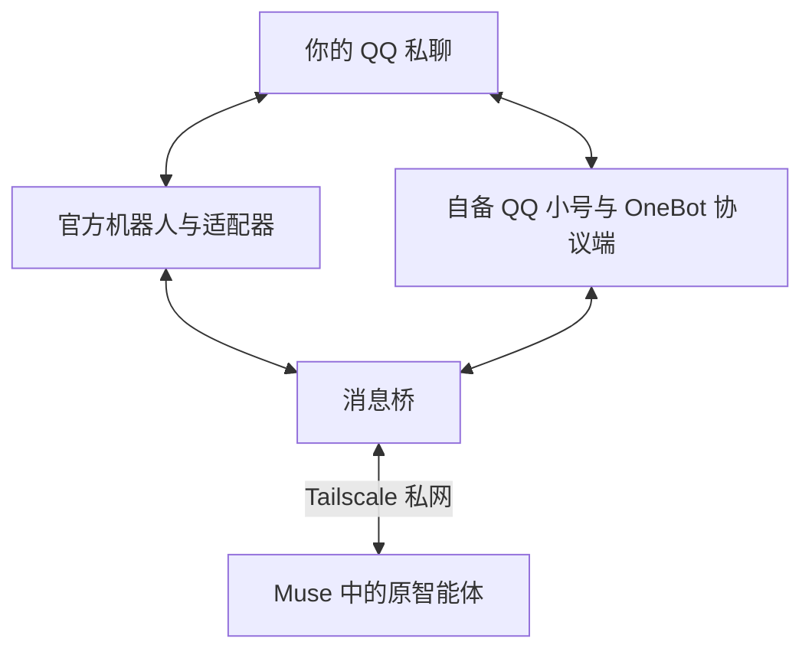

<div align="center">

<h1>Muse 接入 QQ</h1>

<p>让你的 Muse 住进 QQ，继续做那个记得你、陪你聊、也能办事的智能体。</p>

<p><strong>原会话 · 原记忆 · 原工具 · 陪伴与角色扮演 · 18+ / NSFW 说明</strong></p>

<p>
  <a href="https://github.com/anan-21/muse-qq-bridge/actions/workflows/tests.yml"></a>
  <a href="docs/quickstart.md"></a>
  <a href="LICENSE"></a>
</p>

<p>
  <a href="docs/quickstart.md">快速开始</a> ·
  <a href="#两种-qq-接法">QQ 小号接入</a> ·
  <a href="addons/dsh-muse/README.md">DSH + Muse 附加版</a> ·
  <a href="docs/muse-integration.md">接入 Muse</a> ·
  <a href="SECURITY.md">安全说明</a>
</p>

</div>

把 Muse 中现有的智能体接到 QQ 单聊。日常陪伴、角色扮演，或让她查资料、看记忆、调用工具，都交给你原来的 Muse；这座桥负责传话和确认回复。

**不需要另外填写 DeepSeek、OpenAI 等模型 API key。** 回复由你的 Muse 会话生成，需要你自己的 Muse 账号和可用工具环境；QQ 通道和消息桥仍需各自的登录或鉴权配置。

已有 DSH「大肥鱼」的用户另见 [DSH + Muse 自动接力附加版](addons/dsh-muse/README.md)：普通话题走 DSH，命中 Muse 话题规则时带着获准的上下文与记忆交接，恢复普通话题后自动切回。**NSFW / 18+ 可设为 Muse 接管标签**，在调用 DeepSeek 前分流。附加版沿用 DSH 自己的 DeepSeek 配置；首版支持固定上游的 Linux / macOS 源码环境，未支持 Windows 打包版。

## 接上以后，能做什么

| 你想做的事 | 接入后的方式 |
| --- | --- |
| 在 QQ 里找她聊天 | 给接入的 QQ 入口发私聊，收到 Muse 的文字回复 |
| 延续原来的相处方式 | 沿用原会话的记忆、角色设定和已授权工具 |
| 一边聊天，一边办事 | 由 Muse 判断是否需要搜索、查记忆或调用工具 |
| 少一次取件等待 | 收件钩子把正文随唤醒带入，失败时自动退回补取流程 |
| 查清慢在哪一步 | 结合钩子运行记录与回复 helper 的私有日志定位耗时，见 [延迟拆分](docs/latency.md) |

当前桥只转发**一个已授权聊天对象的纯文本私聊**。图片、语音、群聊和主动找你聊天不在当前实现范围内；Muse 生成的文件也不会自动作为 QQ 附件发送。

### 18+ / NSFW：重点也写在这里

**Muse 有成人向文字对话（18+ / NSFW）的公开实测报道。** [WIRED 的采访](https://www.wired.com/story/i-got-my-muse-ai-agent-to-sext-me-and-meta-says-thats-totally-fine/)引述 Meta 发言人表示，成年人可以自愿进行成人对话。

这项能力来自 Muse，具体内容以你使用时的 Muse 能力和规则为准。**Muse 内能聊的内容，不代表腾讯允许通过 QQ 发送。** 使用仅限成年人、自愿且合法的场景；本项目不提供绕过平台限制的功能，也不承诺任何内容一定能生成或送达。

## 两种 QQ 接法

**可以用 QQ 官方机器人，也可以自备 QQ 小号协议端接入。** 两条路共用同一座消息桥，回复仍来自 Muse。

| | QQ 官方机器人 | 自己的 QQ 小号 |
| --- | --- | --- |
| 你在 QQ 里找谁 | 在单聊中找官方机器人 | 用日常账号私聊自己的小号 |
| QQ 侧用什么 | 仓库自带的 botpy 沙箱适配器 | 自备 NapCat 等兼容 OneBot HTTP 的协议端 |
| 需要准备 | 开发者资格、AppID、AppSecret、沙箱体验账号 | 小号、本人完成登录验证、符合桥要求的协议端配置 |
| 当前交付程度 | 提供初始化、身份绑定、部署指南和验收记录 | 保留桥的接入接口；需自行安装、配置并验收，不含小号登录器 |
| 从哪里开始 | [官方路线五步指南](docs/quickstart.md) | [小号 / OneBot 接线说明](docs/onebot.md) |

小号路线涉及第三方客户端登录，存在掉线、限制或封号风险，只用可承担风险的小号。遇到风险设备、冻结或反复下线提示，应暂停排查，不能承诺靠重登保持在线。

### 消息怎么走



上图两条 QQ 路线按需选择，现有部署不要直接切换身份或混用队列。桥保留未确认消息，收到有效发送回执后再确认；结果未知时先核查，避免重复回复。详细端口和接线要求放在部署文档里。

## 开始前准备什么

| 准备项 | 用来做什么 |
| --- | --- |
| 可用的 Muse 会话 | 使用原智能体的记忆、角色设定和工具 |
| Linux 服务器、Python 3.12+ | 运行消息桥；官方路线还需运行仓库内适配器 |
| Tailscale 私网连通 | 让 Muse 的工具环境实际访问消息桥 |
| 一个 QQ 接入方式 | 官方应用凭证，或已配置好的小号协议端 |

Muse 环境需要后台钩子与 shell 执行能力。仅在手机上装了 Muse，或电脑能打开私网地址，都不能代替 Muse 工具环境本身的连通检查。

## 快速开始

先选上面的 QQ 路线。走官方机器人时，服务器初始化命令如下：

```bash
git clone https://github.com/anan-21/muse-qq-bridge.git
cd muse-qq-bridge
python3 -m venv .venv
.venv/bin/python -m pip install -r requirements.txt
.venv/bin/python configure.py --appid YOUR_APP_ID
```

将 `YOUR_APP_ID` 换成自己的 AppID，按提示在服务器终端隐藏输入 AppSecret，再按 [五步指南](docs/quickstart.md) 完成绑定和 Muse 接入。小号路线使用单独的 [OneBot 接线说明](docs/onebot.md)，不要运行官方应用初始化来配置小号。

两条路线都要在 QQ 发一条新消息，确认 Muse 回复确实收到、pending 回到 `0`。桥 token 通过私密文件配置，详见 [脚本安装说明](muse/README.md)。

## 一次现场测速

2026-11-07，同类短消息各测一次，比较从钩子开始到发送确认完成的耗时。

| 优化前 | 自动带正文启用后 |
| ---: | ---: |
| 23.079 秒 | **9.114 秒** |

这是单样本结果，计时从钩子开始，未包含消息在队列中等待下次轮询的时间，也未记录手机显示回复的准确时刻。分段数据和证据范围见 [测速记录](docs/latency.md)。

## 文档导航

| 你想做什么 | 从这里开始 |
| --- | --- |
| 第一次部署 | [五步接入指南](docs/quickstart.md) |
| 用自己的 QQ 小号接入 | [小号 / OneBot 接线说明](docs/onebot.md) |
| DSH 普通话题 + Muse 接力 | [可选附加版：安装、记忆范围与自动切回](addons/dsh-muse/README.md) |
| 配置服务托管或迁移旧部署 | [Linux 部署与迁移](docs/deployment.md) |
| 安装 Muse 钩子与回复 helper | [接入约定](docs/muse-integration.md) · [脚本配置](muse/README.md) |
| 核对接口与访问边界 | [HTTP API](docs/api.md) · [安全说明](SECURITY.md) |
| 测延迟、确认验收范围 | [延迟拆分](docs/latency.md) · [验收记录](docs/verification.md) |
| 排查常见问题 | [踩坑记录](docs/lessons.md) |

## 本地检查

安装依赖后运行。脚本合同测试还需要 Bash、curl 和 jq。

```bash
.venv/bin/python -m unittest discover -v
bash -n muse/qq-bridge-inbox.sh muse/qq-bridge-reply.sh
```

测试使用临时目录、虚构身份和本机替身服务。贡献方式见 [CONTRIBUTING.md](CONTRIBUTING.md)，版本变更见 [CHANGELOG.md](CHANGELOG.md)。

## 许可与上游

代码采用 [MIT License](LICENSE)，第三方许可见 [THIRD_PARTY_NOTICES.md](THIRD_PARTY_NOTICES.md)。

官方适配器使用 [腾讯 botpy SDK](https://github.com/tencent-connect/botpy)，接口资格和配额以 [QQ 开放平台](https://q.qq.com/) 为准。小号协议端由使用者另行取得，参见 [NapCat 文档](https://napneko.github.io/)。本仓库不包含 Muse、QQ 或 NapCat 本体，与这些产品的厂商无隶属关系。
