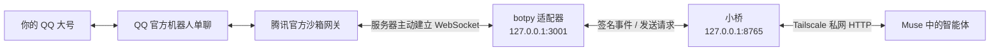

# Muse QQ Bridge

[](https://github.com/anan-21/muse-qq-bridge/actions/workflows/tests.yml)

**大脑在 Muse，QQ 机器人只是手。**

Connect a Muse-hosted agent to an official QQ bot through a private, authenticated message bridge. The adapter transports messages; the existing agent remains the brain.

把 Muse 中的智能体接到 QQ 官方机器人的单聊窗口。服务器只负责收消息、保存待办、转发回复；思考和生成回答仍由 Muse 中原来的智能体完成，不接入额外模型 API。

本项目包含官方机器人适配器、小桥、初始化工具、部署模板和测试。**不包含 Muse 应用、Muse 内部会话或模型实现。** 原始部署于 2026-10-29 由使用者确认完成真实 QQ 收发验收；本开源版另外做了路径和配置通用化，验证范围见 [验收记录](docs/verification.md)。

## 这条链路怎么走



- **官方机器人**是独立应用身份；大号只作为聊天对象，不在服务器登录个人 QQ。
- **适配器**把官方 `user_openid/msg_id` 转换为小桥能理解的事件，维护被动回复上下文。
- **小桥**提供 `/health`、`/inbox`、`/send`、`/ack`，保留消息直到明确确认。
- **Muse**用自己的工具读取队列、生成回复、发送并确认；每分钟轮询是原始用例的做法，不是本仓库自动替你创建的后台服务。

## 快速开始

服务端目标环境：Linux、Python 3.12+。原始验收环境为 Ubuntu 24.04、amd64、Python 3.12；依赖固定为 `qq-botpy==1.2.1` 与 `aiohttp==3.14.5`。平台账号资格、沙箱单聊能力和配额以腾讯当前控制台为准。

### 1. 本人完成官方机器人准备

在 [QQ 开放平台](https://q.qq.com/) 注册开发者、创建机器人，取得 AppID 与 AppSecret。在沙箱中加入自己的体验 QQ，再通过官方入口添加机器人，打开单聊。

本项目强制沙箱模式。如果平台要求额外资质或审核，先处理平台权限；程序不会替你提交材料、发布上架或改用个人 QQ 挂机。

### 2. 在服务器初始化

```bash
git clone https://github.com/anan-21/muse-qq-bridge.git
cd muse-qq-bridge
python3 -m venv .venv
.venv/bin/python -m pip install -r requirements.txt
.venv/bin/python configure.py --appid YOUR_APP_ID
```

最后一步在服务器终端隐藏输入 AppSecret。配置写入 `data/config/`，目录权限 `700`、文件权限 `600`。内部 token 自动生成；重复初始化保留原桥接 token 和签名密钥。

`--owner-id` 默认 `10001`，只是本地兼容字段的数字别名，不是 QQ 号或 `user_openid`。真正的主人身份在下一步用临时绑定语句确认。

### 3. 启动并绑定

在两个服务器终端分别运行：

```bash
.venv/bin/python adapter.py ./data
```

```bash
.venv/bin/python run_bridge.py ./data
```

检查适配器：

```bash
curl -fsS http://127.0.0.1:3001/health
```

必须看到 `sandbox=true`、`gateway_ready=true`。然后生成绑定语句：

```bash
.venv/bin/python issue_binding.py --data-dir ./data
```

用体验 QQ 给机器人发送输出的完整语句，15 分钟内有效。它只绑定身份，不入桥队列、不自动回复。再次查看 health，确认 `owner_bound=true`。其他发送者一律丢弃，不会因为“第一个发消息”而自动获得主人身份。

要作为 systemd 服务运行，见 [部署说明](docs/deployment.md)。

### 4. 通过私网连接 Muse

服务器和运行 Muse 工具的设备必须具有实际可达的私网 HTTP 通道。Tailscale 是原始部署使用的方案；服务端授权和客户端接入由本人完成。

安装并登录 [Tailscale](https://tailscale.com/kb/1017/install)，然后仅在 Tailnet 暴露桥：

```bash
sudo tailscale serve --bg --http=8765 http://127.0.0.1:8765
tailscale serve status
```

这里使用 Tailscale **Serve**，不要启用公网 Funnel。适配器的 3001 端口不需要对其他设备开放。记录自己实际得到的设备域名，将桥的私网地址与 `BRIDGE_TOKEN` 配置到 Muse 的安全工具变量。

AppSecret 留在服务器；Muse 只需要访问桥的 token。不要把凭证放进聊天正文、URL 查询参数、Git 提交或截图。

### 5. 让 Muse 中的原智能体接管

参考 [Muse 接入提示词与轮询约定](docs/muse-integration.md)，为原智能体提供 HTTP 工具和桥地址。顺序是：

1. 读取 `/inbox`。
2. 由原智能体本人生成回答。
3. 通过 `/send` 发出，检查确认结果。
4. 只有发送成功后才 `/ack` 原消息。

在 QQ 发送“官方测试，1+1等于几？”。确认 pending 从 `0` 变为 `1`，由 Muse 回答，最后本人确认在机器人单聊中收到“2”。这才算端到端通过；服务在线或模拟测试通过都不能替代实际收发。

## 关键点与当前限制

- **不把 HTTP 200 当作发送成功。** 适配器需要真实消息回执；上游业务失败保留非零错误码。
- **发送结果未知不自动重发。** 发送前落盘占位，超时、连接重置或崩溃后保留未知状态；入站重复事件则按稳定消息 ID 去重。
- **先绑定，再转发。** `user_openid` 不能直接当 QQ 号比较，也不能信任任意首个发消息的人。
- **私网不等于免鉴权。** 远端桥 token、内部 OneBot token、事件 HMAC 分工不同，不能省略。
- **只支持单一主人、纯文本、被动回复。** 不接群聊、附件、多用户和主动推送。回复使用最近入站的上下文；并发多个问题时不保证逐条对应。
- **当前本地回复窗口为 290 秒。** 这是实现的保守策略，不是对腾讯现行时限的声明。轮询与处理要留出时间；过期返回 `1408`，不回退主动发送。
- **一分钟轮询需要 Muse 本身的能力。** 本仓库提供 HTTP 协议，不保证某个客户端在系统休眠、后台受限或工具断连时仍会执行。
- 状态库与队列包含私人信息。acked 只表示确认，不表示自动销毁历史；保留策略由部署者管理。

## 文档和测试

- [部署与迁移](docs/deployment.md)
- [Muse 侧接入和任务权限](docs/muse-integration.md)
- [HTTP 接口](docs/api.md)
- [安全与凭证分工](SECURITY.md)
- [踩坑记录](docs/lessons.md)
- [验收范围](docs/verification.md)

```bash
.venv/bin/python -m unittest discover -v
```

测试使用临时目录、虚构账号、dummy key 和临时 loopback 服务，不连接腾讯、不调用模型、不访问实际队列。

## 上游与许可

本项目使用 [腾讯官方 botpy SDK](https://github.com/tencent-connect/botpy)，接口能力以 [QQ 官方开发文档](https://bot.q.qq.com/wiki/) 为准。

代码采用 [MIT License](LICENSE)，第三方许可见 [THIRD_PARTY_NOTICES.md](THIRD_PARTY_NOTICES.md)。这是独立的集成项目，不代表 Muse、腾讯或 Tailscale 官方。
