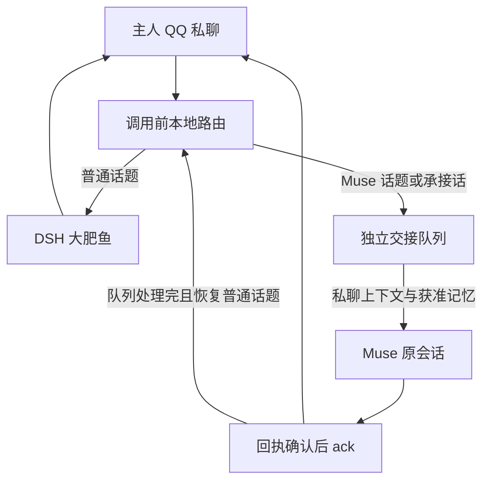

# DSH + Muse：在同一个 QQ 私聊里自动接力

平时让 DSH「大肥鱼」回复；命中配置的 Muse 话题规则时，**在调用 DeepSeek 前**把本次消息、当前私聊上下文和获准共享的记忆交给 Muse。普通话题恢复后自动切回 DSH，保留 `/muse`、`/dsh`、`/auto` 手动控制。

例如可以把 **NSFW / 18+ / 成人向**设为 Muse 接管标签。它是调用前的分流：不先要求 DSH 作答，不把拒绝当成重试信号，也不给任一模型添加绕过规则的提示。Muse 按自己的能力与规则处理；QQ 的发送规则仍适用。

这是主项目之外的**可选附加版**。原来的「只用 Muse 接 QQ」继续照常使用。

## 先看支持范围

| 项目 | 本版范围 |
| --- | --- |
| QQ 入口 | 已能正常运行的「大肥鱼」个人 QQ / OneBot 私聊；一个指定主人；纯文本 |
| DSH | 固定上游源码版本的 DSHFish；**Linux / macOS 源码运行环境** |
| Windows 打包版 | 暂未支持；不能把本补丁直接套进 Windows 一键安装包，也不跳过文件权限检查 |
| Muse | 已有会话、后台 hook 与 shell 工具环境，能实际访问 Tailscale 私网 |
| 交接服务 | Python 3.12+，独立进程、独立队列与凭据，不复用原桥数据 |
| 模型费用 | DSH 沿用其 DeepSeek 配置；Muse 沿用其账号；本地路由不调用额外分类模型 |
| 验证程度 | 本机替身服务的离线测试通过；未宣称真实 QQ / Muse 部署或端到端验收已完成 |

上游基线：[`kylian-08/dafeiyu-qq-bot`](https://github.com/kylian-08/dafeiyu-qq-bot/tree/a16bb96e1f0997fda063ec46bc965622e58d6bb7)，提交 `a16bb96e1f0997fda063ec46bc965622e58d6bb7`，`dsh-fish` 0.2.8。DSH 的来源是 [DeepSeek Harness](https://github.com/deepseek-ai/deepseek-harness)。安装器核对被修改文件的摘要，遇到不同版本会拒绝修改。

## 消息如何走



默认是**本地词表规则**，不是通用语义分类器。`NSFW`、`18+`、`成人向`等标签触发 Muse；“继续”“然后呢”留在 Muse。明确的普通任务（如“帮我写代码”或“说回正事”），或连续两条命中普通话题词表的消息，会尝试返回 DSH。任一待处理、发送中或结果未知的 Muse 交接都会延后返回，避免两边同时回答。

词表可配置，无法保证识别所有隐含话题。**不会因为没识别到而先让 DSH 生成，再转发其拒绝。** 需要确定走向时使用命令：

| 命令 | 行为 |
| --- | --- |
| `/muse` 或 `/muse 消息` | 固定由 Muse 接管，直到另一个切换命令 |
| `/dsh` 或 `/dsh 消息` | 请求固定 DSH；尚有 Muse 工作时先延后 |
| `/auto` | 恢复按话题自动切换 |

## 到底会带过去哪些记忆

交接 JSON 分为 `message` 与 `snapshot`：当前消息只处理一次，历史与记忆作为参考资料。
Muse 在处理时读取这些资料，各自的长期记忆库仍由各自产品管理。

- 历史：当前主人私聊里已识别的用户文字与助手回复。不导出工具调用、工具结果、系统提示或思考过程；用户消息中的记忆注入前缀会剥离。
- 长期记忆：默认只导出当前私聊范围、当前私聊来源的活动记忆。主人用户范围的记忆可能曾在群聊等其他场景更新，上游不保存完整来源链；如需共享，必须同时设置 `shareUserMemories: true` 与 `allowCrossChatUserMemories: true`，明确允许该用户范围的跨聊天记忆。单开一项会停止启动，不假装能可靠剥离跨聊天影响。
- 人设：只有 `sharePersona: true` 才导出允许的人设字段与当前私聊范围的记忆，作为资料，不提升为 Muse 的系统指令。
- 不默认导出群聊、其他人的记忆、全局记忆、归档、待审批记忆、凭据、运行配置及第三方扩展的未知存储。

因此这里的“之前的记忆”指**受支持、明确授权的范围**，不是整台机器所有记忆。快照默认上限 2 MiB，超限或格式无法确认就保留消息并报告，不悄悄截断。聊天中曾手工输入的私人内容仍可能属于获准历史，启用导出前请自行核对。

切回 DSH 后，DSH 接续它原有的上下文与新的普通消息；**Muse 那一段原文不会自动回灌给 DeepSeek**。需要承接 Muse 上文的消息应继续留在 Muse。

## 安装步骤

先让原 DSHFish 与 OneBot 正常收发，再加这一层。以下命令只准备新文件；不要把现有桥的 token、数据目录或 hook 配置拿来覆盖。

同一个 QQ 入口只能有这一条接力流程处理消息。如果同一账号还把相同私聊事件上报给原 Muse 桥或其他自动回复消费者，先规划停用重复入口，再启用附加版；否则独立队列无法阻止另一套程序也回复。这里不自动修改任何现有部署。

### 1. 准备独立配置

在 OneBot HTTP 所在机器克隆本仓库。将示例主人号码换成自己的数字 QQ 号；下例只是虚构占位。

```bash
python3 addons/dsh-muse/configure_addon.py \
  --directory "$HOME/.config/dsh-muse-addon" \
  --owner 12345678 \
  --onebot-token
```

OneBot token 在终端隐藏输入。脚本生成两个互不相同的新令牌文件（DSH 与 Muse 各一把），文件权限 `0600`、目录 `0700`，不打印值；若目录已存在会停止，避免覆盖。没有 OneBot token 的本地端点可省略 `--onebot-token`。

生成的 `dsh-router.json` 默认 `enabled: false`、`consentExport: false`。确认导出范围后才把两者改为 `true`。`broker.json` 中 `onebotHttp` 应指向这台机器上已有的 OneBot HTTP 服务，默认 `http://127.0.0.1:3000`。

跨机器时用 `--bind <本机 Tailscale IPv4>` 创建服务配置，端口仍为 `18765`。只使用回环或 Tailscale 私网；不使用公网监听、Funnel 或公网代理。把各自的配置和所需令牌文件通过自己的安全文件通道放到 DSH / Muse 环境，并修改其中的**本地绝对路径**与 `baseUrl`。DSH 只拿 DSH token，Muse 只拿 Muse token；不要把值粘到聊天或提交 GitHub。

### 2. 安装固定上游补丁

按 [集成说明](integration/README.md) 对支持的 DSHFish 源码安装补丁。安装器先核验，再备份；不匹配则停止。启动 DSHFish 时设置 `FISH_MUSE_CONFIG_FILE` 为 `dsh-router.json` 的绝对路径。没有该变量时原行为保持不变。

源码目录、用户数据目录与 Muse 运行目录不一定在同一台机器；配置里的路径都应指向使用它的机器。不要把此仓库路径误当成上游的用户数据目录。

### 3. 启动独立交接服务

```bash
python3 addons/dsh-muse/broker.py \
  --config "$HOME/.config/dsh-muse-addon/broker.json"
```

先检查 `/health` 为 `200`，再确认 DSH 与 Muse 工具环境都能访问。服务只允许一个进程拥有该状态目录。需要常驻时按自己的服务管理方式托管，不与原桥复用 unit、端口或队列。

### 4. 登记专用 Muse 收件钩子

将本目录及脚本放进 Muse 可执行文件环境，配置 `FISH_MUSE_CLIENT_CONFIG` 为 Muse 本地 `muse-client.json` 的绝对路径。让 Muse 按其当前 hooks 接口登记 [模板](muse-hook.template.json)，替换两个绝对路径，先禁用检查，再启用。`HATCH_HOOK_RUNTIME` 由 Muse 提供，本仓库不分发 Muse 本体。

同一个交接队列只能有一个消费者，使用固定 Muse 会话以保留接力期间的连贯性。收件 helper 不读取 token：通过只认真实 Tailscale / 回环来源的只读接口取正文与完整快照，校验摘要后写入本地私密文件。唤醒数据包含当前正文、`id`、`from` 和 `context_file`，不内嵌全部历史。Muse 必须先读该文件再回答。

出站 helper 从 Muse 本地私密文件读取其专用 token，发送成功且拿到 `message_id` 才 ack。**不要替换现有主项目的收发脚本**。

### 5. 用新消息验收

1. 普通消息由 DSH 回复，交接队列为零。
2. 使用无敏感内容的 `NSFW [测试标签]`，确认只进入 Muse，历史文件与授权记忆齐全。
3. Muse 回复确实在 QQ 收到，队列清零。
4. 发“帮我写代码”或“说回正事”，确认自动切回 DSH；“继续”应继续留在 Muse。
5. 重复投递同一事件不多发；服务离线或发送状态未知时不落回 DSH 重试。

真实 Muse/QQ 验收需要部署者完成；离线模拟不能替代这一步。

## 接口与失败恢复

| 接口 | 授权 | 用途 |
| --- | --- | --- |
| `GET /health` | 无 | 待处理计数，不含正文 |
| `POST /dsh/handoff` | DSH Bearer token | 稳定事件 ID 的只入队交接 |
| `GET /dsh/jobs/<id>`、`GET /dsh/status` | DSH Bearer token | 对账与自动返回判断 |
| `GET /inbox`、`GET /dsh/context/<id>` | Muse Bearer token | 取未确认消息与快照 |
| `GET /inbox-tailnet`、`GET /dsh/context-tailnet/<id>` | 真实对端 IP | 仅 `100.64.0.0/10` 与回环；忽略所有转发头 |
| `POST /send`、`POST /ack` | Muse Bearer token | 主人白名单发送，有发送回执才能确认 |

以上是**附加版独立接口**，使用 `Authorization: Bearer`，不是原桥的 `X-Bridge-Token`。回环反向代理必须自身只服务 Tailnet；公网代理会破坏来源判断，不能配置。

状态为 `queued → sending → sent → acked`；中途无法确认发送结果就进入 `unknown`。发送记录在网络请求之前持久化；同一批 ID、同一正文的已确认发送可安全对账，修改正文或结果未知不能再次发送。

- `sent` 但尚未 ack：核对后仅执行 `muse_client.py --config ... ack <ids>`，不重新生成回复。
- `unknown` 或取件失败：暂停核对，不循环重试、不清队列。hook 不会自动唤醒重发未知批次。
- ack 清理 Muse 本地快照缓存，快照接口也停止提供已 ack 内容。**服务器 SQLite 保留历史与去重记录，不等于数据已从磁盘删除**；本地私密存储与备份由部署者管理。不要为了清理空间直接删除去重库后继续接收旧事件。

## 回滚与开发验证

去掉 `FISH_MUSE_CONFIG_FILE` 或设置 `enabled: false` 即停用路由，新普通消息恢复上游流程。保留未确认的交接数据并先核对；不能通过删队列回滚已经发送的内容。需要恢复源文件时使用安装器保存的备份，先核对没有其他改动。

```bash
python3 -m unittest discover -s addons/dsh-muse -p 'test_*.py' -v
python3 -m unittest discover -s addons/dsh-muse/integration -p 'test_*.py' -v
node --test addons/dsh-muse/client/*.test.mjs addons/dsh-muse/integration/test_*.mjs
bash -n addons/dsh-muse/muse-inbox.sh
```

测试使用虚构身份、临时目录与本机 OneBot/Muse 替身，没有真实聊天或凭据。阶段记录见 [IMPLEMENTATION.md](IMPLEMENTATION.md)，客户端规则详见 [client/README.md](client/README.md)。
